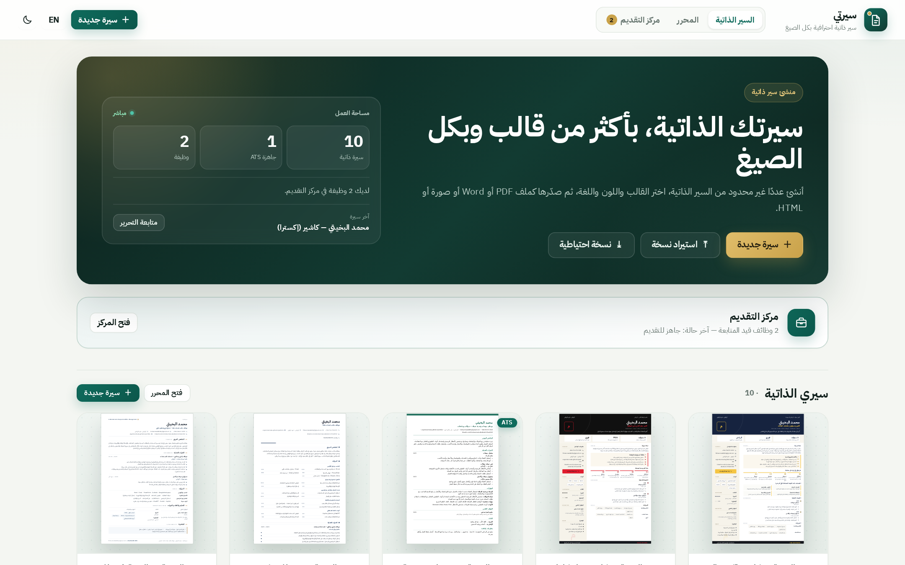
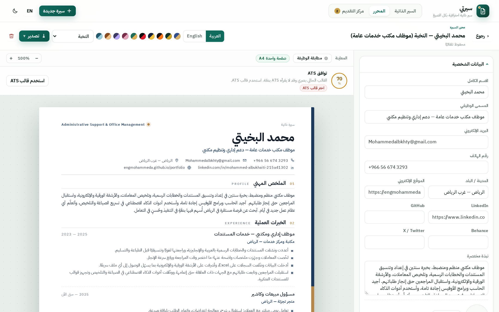
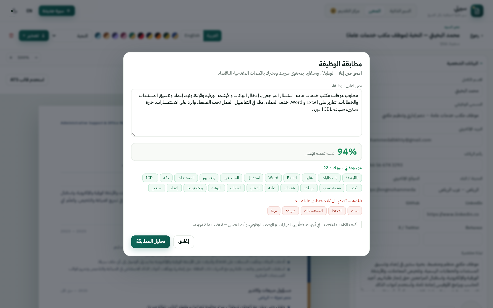

# سيرتي — منشئ السير الذاتية | Sirati CV Builder

تطبيق ويب لإنشاء **عدة سير ذاتية** بقوالب مختلفة، ثم تصدير كل سيرة بصيغ متعددة.
يعمل بالكامل داخل المتصفح: **بدون خادم، بدون تثبيت، وبدون مكتبات خارجية**.

> **الجديد في هذا الإصدار**
> - قالب **«النخبة» (Elite)** — أرقى قالب في التطبيق: عمود واحد، عناوين مرقّمة، خطوط شعرية ومساحات بيضاء محسوبة.
> - **مطابقة الوظيفة**: الصق نص الإعلان ليحسب التطبيق نسبة تغطية سيرتك ويُظهر الكلمات المفتاحية الناقصة.
> - **مؤشر «صفحة واحدة A4»** أعلى المعاينة: يقيس ارتفاع المحتوى فعليًا وينبّهك إن تجاوز الصفحة.
> - **خط IBM Plex Sans Arabic مضمّن** (base64) في الواجهة وفي القوالب والتصدير — نفس الشكل على كل جهاز.
> - **خط إنتاج سيرة احترافي** (`cv/build_elite.py`): ملف بيانات واحد ينتج PDF + Word + HTML معًا.
> - إصلاح خلل قديم كان يجعل أي نقرة داخل النوافذ المنبثقة تُغلقها (بما فيها زر «إنشاء السيرة»).

## لقطات من التطبيق
| الرئيسية | محرر «النخبة» | مطابقة الوظيفة |
|---|---|---|
|  |  |  |

## التشغيل
افتح `index.html` بالنقر المزدوج (يُفضَّل Chrome أو Edge). كل شيء يعمل من الملف مباشرة.

### تشغيل محلي عبر سيرفر (مستحسن للتطوير)
```bash
python3 serve.py            # http://localhost:8080
PORT=3000 python3 serve.py  # منفذ مخصص
```
يستمع على `0.0.0.0` (لذلك يعمل داخل المعاينة السحابية)، ويضيف `no-store` حتى تظهر التعديلات
فورًا، ويضبط أنواع MIME المهمة (`js`, `woff2`, `pdf`, `docx`…) بدل `application/octet-stream`.

## النشر على GitHub Pages
1. من المستودع: **Settings ← Pages**.
2. اختر **Deploy from a branch** ثم الفرع `main` والمجلد `/ (root)`.
3. سيصبح الرابط: `https://engmohammeda.github.io/JOBMY/`.

## المزايا
- عدد غير محدود من السير الذاتية، محفوظة تلقائيًا في `localStorage` (المفتاح: `sirati.cv.v1`).
- **10 قوالب** مصنّفة إلى:
  - **قالبان ATS** (`ats` كلاسيكي، `ats-modern` حديث): عمود واحد، نصوص حقيقية، عناوين قياسية، بدون صورة أو أيقونات أو جداول أو أعمدة جانبية.
  - **8 قوالب بصرية** (عصري، كلاسيكي، بسيط، أنيق، «ملفّي داكن / ملفّي فاتح»، «احترافي»، و**«النخبة»** الجديد): «النخبة» هو القالب المرجعي — عمود واحد، شريط جانبي رفيع بلمسة ذهبية، عناوين أقسام مرقّمة، خطوط شعرية، ومساحات بيضاء محسوبة؛ بلا زخرفة وبلا تكدّس.
- **فاحص توافق ATS مباشر** أعلى المعاينة: درجة من 100، قائمة نواقص، وزر تحويل فوري إلى قالب ATS.
- **مطابقة الوظيفة** (زر أعلى المعاينة): تحليل فوري لنص إعلان الوظيفة مقابل محتوى السيرة — نسبة تغطية، المصطلحات الموجودة، والناقصة. يعمل محليًا بلا أي إرسال للبيانات، ويفهم العربية والإنجليزية (توحيد الهمزات والتاء المربوطة وإزالة «ال» التعريف).
- **مؤشر الصفحة الواحدة**: شارة «صفحة واحدة A4» أو تنبيه بفارق التجاوز بالمليمتر — قبل أن تطبع وتكتشف الصفحة الثانية.
- **خطوط مضمّنة**: IBM Plex Sans Arabic (5 أوزان، عربي/لاتيني) داخل `index.html` — تظهر السيرة بنفس الشكل على أي جهاز أو متصفح.
- حقول روابط مهنية: الموقع الإلكتروني، LinkedIn، GitHub، Behance، وX/Twitter — تظهر في القوالب والتصدير.
- 10 ثنائيات لون (لون أساسي + لون ثانوي) تُطبَّق كنقشة دائرية في لوحة الألوان.
- 8 سير جاهزة (محمد البخيتي بإصدارات وظيفية مختلفة — منها **النخبة: موظف مكتب خدمات عامة** بقالب «النخبة»، و**موظف مكتب خدمات عامة — غرب الرياض** بقالب «احترافي»، و**مبيعات وخدمة عملاء — جوالات**) تُستورد تلقائيًا مرة واحدة عند أول تشغيل.
- لغتان للسيرة (عربي RTL / إنجليزي LTR) مستقلتان عن لغة الواجهة.
- واجهة عربية/إنجليزية + وضع ليلي.
- صورة شخصية (تُقصّ مربّعة تلقائيًا) تظهر في القوالب البصرية والتصدير، وتُتجاهَل تلقائيًا في قوالب ATS.
- «إضافات التصميم» للقالبين الملفّيين: عنوان إنجليزي، سطر تعريفي، بطاقات أرقام، صندوق عرض، خطوات عمل، شبكة خدمات، أدوات، جاهزية، وزر واتساب.
- إعادة ترتيب العناصر والمهارات والأقسام بأسهم أعلى/أسفل، وتجميع المهارات تحت مجموعات.
- نسخ سيرة، حذف، واستيراد/تصدير نسخة احتياطية JSON.

## مركز التقديم — متابعة الوظائف
- لوحة وظائف جانبية مع البحث والفلترة حسب الحالة (جاهز، تم التقديم، مقابلة، عرض، انتظار، انسحاب، رفض).
- لكل وظيفة: تفاصيل، ملاحظات، خط زمني، سيرة مرتبطة، ورسائل تقديم جاهزة قابلة للتعديل والنسخ وفتح واتساب.
- 13 رسالة تقديم ومتابعة، 14 سؤال مقابلة بإجابات، وقاعدة معرفة بأكثر من 35 مهارة في بيع وصيانة الجوالات.
- وظيفتان جاهزتان في قاعدة البيانات: **موظف مبيعات وخدمة عملاء — جوالات** و**موظف مكتب خدمات عامة — غرب الرياض**.
- إضافة/تعديل/حذف الوظائف، تصدير بيانات المركز JSON، وحفظ تلقائي في `localStorage` (المفتاح: `sirati.career.v1`).
- الوصول من شريط التنقل العلوي أو من بطاقة «مركز التقديم» في الرئيسية.

## ATS — أنظمة التقديم الآلي
### هل القوالب السابقة تدعم ATS؟
**لا بشكل موثوق.** القوالب الستة البصرية مبنية على أعمدة جانبية، أيقونات، صور، ألوان وتخطيطات معقّدة. قد يقرأها بعض أنظمة ATS، لكن من الشائع أن يختلط ترتيب الأقسام أو تُفقد بعض الحقول. لا يُنصح باستخدامها عند التقديم عبر بوابة وظائف تعتمد ATS.

### القالبان الجديدان
- `ats` — **ATS كلاسيكي**: أبيض وأسود، ترويسة في الوسط، عناوين أقسام قياسية، عمود واحد.
- `ats-modern` — **ATS حديث**: نفس بنية الأمان مع لون أساسي في الاسم والعناوين.

كلاهما:
- عمود واحد فقط، وترتيب DOM منطقي (الاسم ← المسمى ← التواصل ← الأقسام).
- عناوين `<h1>/<h2>` وأقسام `<section>` وقوائم `<ul>/<li>` حقيقية.
- بلا صورة، بلا أيقونات، بلا جداول، بلا صناديق نص، بلا ترويسة/تذييل صفحة.
- يتجاهل «إضافات التصميم» غير القياسية، ويعرض الأدوات ضمن المهارات والجاهزية كسطر «معلومات إضافية».
- عند تصدير Word من قالب ATS تُستبعد الصورة تلقائيًا.
- عند حفظ PDF من نافذة الطباعة، أزل خيار **ترويسة/تذييل الصفحة** (Headers and footers) ليبقى الملف نصيًا نظيفًا.

### فاحص ATS
يعطي درجة من 100 بناءً على: نوع القالب، الصورة، البريد والهاتف، المسمى الوظيفي، المدينة، طول الملخص، وجود خبرة بوصف، عدد المهارات، والمؤهل العلمي. الدرجة **إرشادية** ولا تضمن قبول أي نظام بعينه؛ استخدمها لتحسين الأساسيات.

## التصدير
| الصيغة | الطريقة | ملاحظات |
|---|---|---|
| PDF | الطباعة (`window.print`) → «حفظ كـ PDF» | متجهي، نص قابل للتحديد؛ الصورة تظهر في القوالب البصرية فقط |
| Word `.docx` | بناء ملف Office Open XML + ZIP يدويًا | نص حقيقي قابل للتعديل؛ بلا صورة عند قالب ATS |
| PNG | `SVG foreignObject` → canvas بدقة مضاعفة | صورة كاملة للسيرة |
| HTML | صفحة مستقلة بتنسيقات القالب | جاهزة للنشر أو الطباعة |
| TXT | نص عادي منظم | مناسب للنسخ أو التقديم عبر ATS |
| JSON | كل السير دفعة واحدة | نسخ احتياطي/استيراد |

> تصدير HTML وPNG بات يضمّن **الخطوط المضمّنة** تلقائيًا، فيبقى الملف الناتج سليمًا على أي جهاز بدون إنترنت.

## البنية
```
index.html          الواجهة + CSS (وسوم: #app-styles للواجهة، #cv-styles للقوالب، #app-v2 للهوية البصرية)
js/data.js          الترجمات، القوالب، renderCv()، مولّد ATS، البيانات التجريبية
js/elite.js         قالب «النخبة»: بناء الأقسام المرقّمة ديناميكيًا + التذييل
js/match.js         محرّك مطابقة الوظيفة: استخراج المصطلحات، التطبيع العربي، حساب التغطية
js/presets.js       السير الجاهزة المستخرجة من ملفات PDF المرفقة (8 سير)
js/export.js        تصدير PDF/Word/PNG/HTML/TXT/JSON
js/app.js           الحالة، الرئيسية، المحرر، الحفظ التلقائي، الصورة، فاحص ATS، الاستيراد
js/career-data.js   بيانات مركز التقديم: الوظائف، الحالات، الرسائل، المقابلات، مهارات الجوالات
js/career.js        منطق مركز التقديم: القائمة، الفلاتر، الرسائل، الخط الزمني، النماذج، التصدير
cv/build_elite.py   خط إنتاج «النخبة»: data.json → cv-elite.{html,pdf,docx} + حقن الخطوط والقالب في index.html
cv/elite/data.json  المصدر الوحيد لبيانات سيرة النخبة (كل الحقول قابلة للتعديل من ملف واحد)
cv/elite/cv.css     تصميم ورقة السيرة المستقلة (A4، طباعة، شريط جانبي، عناوين مرقّمة)
cv/elite/template.css  نفس التصميم بصيغة القالب داخل التطبيق (.tpl-elite)
cv/preview_elite.py معاينة أثناء التطوير: يقيس ارتفاع المحتوى بالمليمتر ويصوّر الورقة
cv/build_pdf.py     بناء السيرة PDF من القالب «الاحترافي النظيف» (A4، صفحة واحدة، روابط قابلة للنقر)
cv/build_docx.py    بناء السيرة Word (RTL، قوالب نظيفة، قابلة للتعديل)
cv/build_html.py    بناء نسخة HTML تفاعلية مستقلة (خط Cairo مدمج، تعديل مباشر، طباعة/حفظ PDF)
cv/cv-general-services.{pdf,docx,html}  السيرة النهائية لوظيفة موظف مكتب خدمات عامة — غرب الرياض
cv/رسالة-التقديم.md  رسالة الواتساب/البريد/فقرة التوضيح/أسئلة المقابلة — تُرسل منفصلة عن السيرة
```

## نموذج البيانات
```js
{
  id, name, template, accent, accent2, lang, created, updated,
  personal: {
    fullName, jobTitle, email, phone, city,
    website, linkedin, github, behance, x,
    summary, photo
  },
  extra: {
    mini, english, intro,
    highlights: [{ value, label }],
    offerTitle, offerItems: [String],
    processTitle, process: [{ title, desc }],
    gridTitle, grid: [{ title, desc }],
    tools: [String],
    readinessTitle, readiness: [String],
    footerNote, whatsapp
  },
  experience:    [{ role, company, start, end, current, description }],
  education:     [{ degree, school, start, end, current, note }],
  skills:        [{ name, level /* 1..5 */, group }],
  languages:     [{ name, level /* 1..5 */, note }],
  projects:      [{ name, link, description }],
  certifications:[{ name, issuer, year }]
}
```

## إضافة قالب جديد
1. أضف عنصرًا إلى `TEMPLATES` في `js/data.js`:
   ```js
   { id: 'my-template', name: { ar: 'قالبي', en: 'My Template' },
     desc: { ar: 'وصف قصير', en: 'Short description' } }
   ```
   أضف `ats: true` إن كان القالب متوافقًا مع ATS.
2. أضف دالة العرض (أو فرعًا في `renderCv`) تُرجع HTML داخل `<div class="cv-page tpl-my-template">`.
3. أضف تنسيقات القالب في وسم `#cv-styles` داخل `index.html` تحت `.tpl-my-template`.
4. اختبره في المعاينة وفي التصدير. قوالب ATS يجب أن تلتزم: عمود واحد، نصوص حقيقية، بلا صور/أيقونات/جداول، وعناوين أقسام قياسية.

## ملاحظات تقنية
- لا تستخدم `ES modules` ولا `fetch` لملفات محلية، حتى يظل التطبيق يعمل من `file://`.
- تصدير PNG يعتمد على `#cv-styles` المضمّن وعلى خطوط النظام؛ تجنّب خطوطًا خارجية.
- قبل الطباعة يُنسخ القالب إلى `#print-area` وتُخفى بقية الواجهة عبر CSS الطباعة.
- عند التصدير إلى Word تُبنى أجزاء OOXML وتُضغط بطريقة «store» (بدون ضغط) مع CRC32.
- قالبا «ملفّي» مضبوطان ليتّسع محتوى السير الست داخل صفحة A4 واحدة في Chrome/Edge على ويندوز.
- قالبا ATS مضبوطان أيضًا لصفحة A4 واحدة مع السير الست.
- الإضافات (`extra`) تظهر في القوالب البصرية وتصدير Word وTXT، وتُستبعد من عرض ATS.
- تُخزَّن السير الجاهزة مرة واحدة فقط عبر مفتاح `sirati.presets.v1`.
- الخطوط تُحقن عبر `python3 cv/build_elite.py --embed` بين علامتَي `/* >>> ELITE-FONTS >>> */` و`/* >>> ELITE-CV-CSS >>> */` داخل `index.html`؛ لا تُحرّر هذه الكتل يدويًا.
- «مطابقة الوظيفة» تعمل بالكامل في المتصفح؛ لا يُرسل نص الإعلان إلى أي خادم.
- مؤشر «صفحة واحدة» يقيس نسخة مخفية من الورقة لأن ظهور التمرير/التحجيم يؤثر على القياس.

## أفكار تطوير
نسخ متعددة لكل سيرة، سحب وإفلات لترتيب الأقسام، إخفاء أقسام، استيراد من LinkedIn/PDF، مزامنة سحابية، PWA أوفلاين، مولّد خطاب تقديم من نفس بيانات السيرة، ومقارنة عدة سير مقابل الإعلان نفسه واختيار الأنسب.

## سيرة «النخبة» الجاهزة
الملفات النهائية للإرسال موجودة في `cv/`:
| الملف | الاستخدام |
|---|---|
| `cv-elite.pdf` | النسخة الرسمية للإرسال (A4، صفحة واحدة، نص قابل للتحديد، روابط قابلة للنقر) |
| `cv-elite.docx` | نسخة Word قابلة للتعديل (خط عربي RTL، اتجاه أرقام صحيح) |
| `cv-elite.html` | نسخة تفاعلية مستقلة تعمل بلا إنترنت (خطوط مدمجة، زر طباعة، وضع تعديل) |

لإعادة توليدها بعد تعديل `cv/elite/data.json`:
```bash
python3 cv/build_elite.py            # الكل: تضمين + HTML + PDF + Word
python3 cv/build_elite.py --pdf      # PDF فقط
python3 cv/build_elite.py --docx     # Word فقط
```
يتطلب PDF: `pip install playwright && python3 -m playwright install chromium`.
